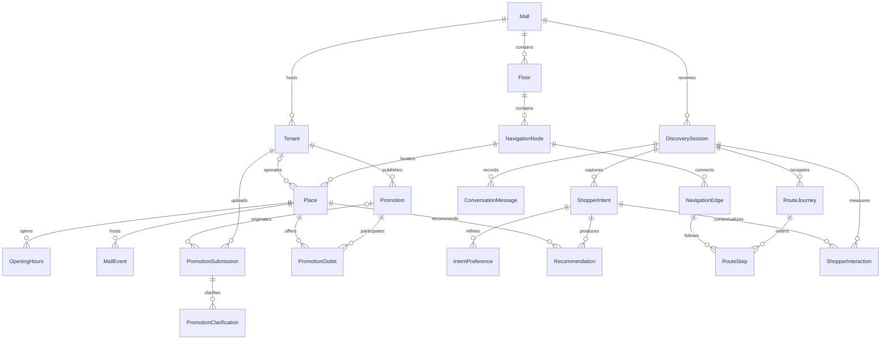

# Data model

## Three parties, one shared knowledge base

| Party | Entities | Purpose |
| --- | --- | --- |
| Mall | Mall, Floor, Place, PlaceTag, OpeningHours, MallEvent | Confirmed directory, facilities and event information |
| Mall | NavigationNode, NavigationEdge | Explicit physical topology, independent of generated directions |
| Mall and tenant | StaffMembership | External identity subject and scoped management role |
| Tenant | Tenant, Promotion, PromotionOutlet, PromotionTag | Tenant profile, confirmed offers, participating outlets and discovery context |
| Tenant | PromotionSubmission, PromotionClarification | Poster provenance, extraction draft and follow-up answers |
| Shopper | DiscoverySession, ConversationMessage | Anonymous session and separately retained conversation text |
| Shopper | ShopperIntent, IntentPreference, Recommendation | Versioned intent and recommendations tied to that exact intent |
| Shopper | RouteJourney, RouteStep | Route revision and ordered verified graph edges |
| Mall analytics | ShopperInteraction | Structured recommendation, selection, directions and recovery events |

`Tenant` represents a mall tenant business; `Place` represents a physical destination.
A tenant may have multiple outlets. Facilities need no tenant. A place gets its floor
through its navigation node, avoiding conflicting floor fields.

`Mall.LogoAssetPath` is an optional public branding asset. `Promotion.PosterAssetPath`
is the public reviewed artwork shown to shoppers. `PromotionSubmission.AssetStorageKey`
retains upload provenance separately. Demo submissions use the same generated public
poster as their source; actual unreviewed uploads must use private storage.

## Tenant content lifecycle

1. Upload asset to private storage; save its storage key and content type in a submission.
2. Save raw structured extraction in `ExtractedDraftJson`, with model and prompt versions.
   This is untrusted staging content, not a source for shopper answers.
3. Record field-specific clarification questions and answers.
4. Validate reviewed fields and create/update a draft promotion in a transaction.
5. Set confirmation identity/time and publish after checking participating outlets.

Extraction status and promotion publication status are independent. Reprocessing a poster
must not silently replace an already confirmed offer. Unknown enrichment fields remain
null rather than becoming false or zero. Missing poster years require confirmation.
The discovery readiness indicator should be derived from applicable fields, not persisted
as an arbitrary percentage.

An active promotion must be Published, belong to an active tenant, cover the mall-local
calendar date inclusively, and participate at the recommended active outlet. Publication
does not by itself mean a promotion is currently valid. Archived promotions remain for history.

## Shopper and analytics lifecycle

Create a session without an account. Record a message, then append an intent revision
carrying the full current intent, including prior preferences and exclusions. Store the
revision's source message. Recommendations belong to that revision, not just the session.
Intent kind defaults to Explore; missing age, budget and time remain unknown.

Record events only when the corresponding UI action occurs. RecommendationShown means
rendered, not merely generated. DestinationSelected means selected, not a confirmed visit.
DirectionsRequested does not mean arrival or purchase. Emit RouteRecovered when a new
route revision has actually been calculated. Arrival status requires an explicit signal.
Future write endpoints must make retries idempotent so duplicate requests do not inflate counts.

Dashboard totals should count distinct sessions for demand, choose one latest intent
revision per session for the reporting cutoff, and count events separately for engagement.
Attribute promotion interest through the referenced recommendation. Compare equivalent
reporting periods before describing trends. Filter simulated sessions explicitly and
show simulated history separately from live interactions. No stored dashboard totals or
AI-generated insight entities are needed yet: aggregates are derived from structured records.

Random session IDs are pseudonymous identifiers, not proof of anonymization. Raw messages
may contain personal information and must not be sent to management summaries. Implement
retention/deletion and minimum aggregation thresholds before collecting real visitor data.
All foreign keys use restricted deletion so deletion must be explicit and ordered.

## Navigation and units

Edges are directed. A two-way corridor has two rows with separate human-authored
instructions. Cross-floor edges represent lifts, stairs or escalators. The route algorithm
uses distance, open status and step-free eligibility. Nodes use schematic floor coordinates;
edge distances use metres. No routing algorithm is implemented in this slice.

Each RouteJourney is one route calculation. Recovery appends a new revision and ordered
steps rather than mutating the previous route. Step instructions can be generated later
from this sequence; the model never invents connections. Keep graph edits controlled:
historical steps currently reference existing edges, not immutable topology snapshots.

Use UTC `DateTime` values for instants and the mall's IANA time zone for local display.
Use `DateOnly` for inclusive promotion dates and local `TimeOnly` for weekly hours.
Hours support one interval per weekday, including overnight closing; exceptional holiday
hours and split opening intervals are outside this prototype scope.
Store money in integer minor units (sen for MYR), using the mall's currency.

## Enforced in the database

- Foreign keys, composite join keys and restricted deletion.
- Unique floor levels, directed edges, unit numbers within a mall and daily opening records.
- Unique message sequences, intent revisions, recommendation ranks and route revisions.
- Source message and intent must belong to the same session.
- Interaction intent, recommendation and route references must match their linked context.
- Positive route distances; no self-edges; valid event/session and promotion periods.
- Nonnegative age, money and advance-order values; coherent minimum/maximum ranges.
- Published promotions require confirmation metadata.
- Mall managers have no tenant scope; tenant editors require a tenant scope.

## Required in future write services

These checks involve multiple tables or workflow context and are not enforced by the
current foreign keys. There are no write endpoints yet.

- Authorize staff identity against membership; verify membership tenant belongs to its mall.
- A place's node and tenant must belong to its mall. Edge endpoints must belong to the same
  mall, including valid cross-floor connectors.
- Promotion outlets must belong to that promotion's tenant. Submission and linked promotion
  must have the same tenant. Publication requires at least one participating outlet.
- Session current node, recommended place, route start and destination must share its mall.
- A recommendation's optional promotion must participate at its place and be active at
  recommendation time. Recommendation text must use only confirmed source facts.
- Route steps must start at the journey's starting node, connect consecutively, terminate
  at the destination's node, and respect open/step-free requirements.
- Validate enum values, required nonblank strings and maximum lengths at the DTO boundary;
  SQLite does not enforce declared string lengths. Normalize tags before saving.
- Validate opening intervals, UTC timestamps, trusted confirmation identities, valid JSON
  extraction schemas and allowed status transitions. Confirmation metadata alone is not
  an authorization or verification mechanism.
- Apply transactions, concurrency control and idempotency to review/publish and session
  writes. A filtered unique index handles mall-manager membership with null tenant scope.

## LLM boundary

Future extraction writes staging drafts. Future intent extraction writes validated intent
snapshots. Recommendation generation selects known place/promotion IDs and explains why.
Resolve actual names, terms, dates and locations from confirmed records in response DTOs.
Management summaries consume computed aggregate facts, not raw conversation text.
No model SDK or prompt implementation is included in the scaffold.

EF relationship configuration follows the [official EF Core relationship guidance](https://learn.microsoft.com/en-us/ef/core/modeling/relationships).
